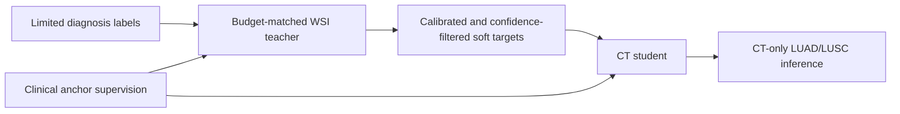

# CT–WSI Privileged Learning

This repository contains the minimal code path for label-efficient LUAD/LUSC classification with training-time pathology and clinical privileged supervision. A pathology teacher supplies calibrated, confidence-filtered soft targets for diagnosis-unlabeled training cases, while three biological anchors provide auxiliary supervision. The deployed classifier requires CT features only.

## Motivation

Pathology features are highly informative but may be unavailable at CT inference time. We study whether they can improve a deployable CT classifier when diagnosis labels are scarce, without making pathology or clinical variables inference requirements.

The study uses 320 paired cases (165 LUAD and 155 LUSC), five patient-level folds, and diagnosis-label budgets of 25%, 50%, and 100%. Labels are encoded as `0 = LUAD` and `1 = LUSC`.

## Method



The CT encoder maps a 512-dimensional feature through `512 → 512 → 256 → 128`. The pathology encoder maps 1792-dimensional patch features through `1792 → 512 → 128`, followed by mean pooling. T-size, CYFRA abnormality, and SCC abnormality are training-only auxiliary targets with independent missing-value masks.

For every label budget, the pathology teacher receives exactly the same diagnosis-label subset as the CT model. Temperature calibration, confidence selection, and optional clinical-reliability filtering use only an inner labeled split of the outer training fold. Outer validation data are never used to fit or select the teacher, thresholds, normalization, or pseudo labels.

## Results

All values below are pooled five-fold out-of-fold AUC under one consistent protocol.

| Diagnosis labels | CT-only | CT + anchors | CT self-training | Privileged WSI → CT |
|---:|---:|---:|---:|---:|
| 25% | 0.8416 | 0.8508 | 0.8272 | **0.8733** |
| 50% | 0.8835 | 0.8835 | 0.8643 | **0.8878** |
| 100% | 0.8997 | 0.9003 | 0.9003 | **0.9003** |

At 25% diagnosis labels, training-time pathology privilege improves pooled OOF AUC by 3.17 points over CT-only and by 4.61 points over CT self-training. Gains diminish as CT diagnosis supervision increases.

For reference, the training-time pathology teacher reaches pooled OOF AUCs of 0.9525, 0.9683, and 0.9678 at the 25%, 50%, and 100% budgets. It is not the deployment model.

Aggregated results are provided in [`results/final_metrics.json`](results/final_metrics.json). No sample-level outputs are distributed.

## Repository structure

```text
configs/example.yaml          Placeholder data paths and training settings
src/models.py                 CT, WSI, and clinical-anchor heads
src/data.py                   Feature and masked-anchor data loading
src/losses.py                 Masked anchor and soft-target losses
src/training.py               Training, calibration, filtering, and metrics
scripts/train_ct_baseline.py  CT-only and CT+anchor baselines
scripts/train_wsi_teacher.py  Budget-matched pathology teacher
scripts/train_privileged_student.py
                              CT self-training and privileged WSI transfer
scripts/evaluate.py           Five-fold aggregate evaluation
scripts/smoke_test.py         Synthetic end-to-end sanity check
```

## Data format

Data and extracted features are not distributed with this repository.

- CT: a pickle mapping `sample_id` to a float32 array with shape `[512]`.
- WSI: one NumPy file per sample with shape `[P, 1792]`, typically about 2,000 patches.
- Manifest CSV: `sample_id,label`.
- Clinical CSV: `sample_id,t_size_max_cm,t_size_mask,cyfra_abnormal,cyfra_abnormal_mask,scc_abnormal,scc_abnormal_mask`.

Create a private config from `configs/example.yaml`. Do not commit local data paths or derived outputs.

## Running the code

Install the minimal dependencies:

```bash
python -m pip install -r requirements.txt
python -m compileall src scripts
python -m scripts.smoke_test
```

For each fold and budget, train the two initialization models and then the privileged student:

```bash
python -m scripts.train_ct_baseline --config configs/local.yaml --fold 0 --budget 25
python -m scripts.train_ct_baseline --config configs/local.yaml --fold 0 --budget 25 --with-anchors
python -m scripts.train_wsi_teacher --config configs/local.yaml --fold 0 --budget 25
python -m scripts.train_privileged_student --config configs/local.yaml --fold 0 --budget 25 --teacher wsi
```

Use `--teacher ct` for the matched CT self-training control. Repeat folds 0–4, then aggregate:

```bash
python -m scripts.evaluate --config configs/local.yaml --budget 25 --method privileged_wsi
```

## Evaluation safeguards

- Diagnosis-labeled subsets are deterministic, stratified, nested across budgets, and shared by all methods.
- Diagnosis-unlabeled subtype labels are not loaded by either teacher.
- T-size normalization and binary-anchor class weights use outer-training cases only.
- Outer validation cases are evaluated once and do not select training settings.
- WSI and clinical variables are used only during training. Inference requires CT features only.

## Limitations

The evaluation is internal and uses pre-extracted features from one cohort. No external validation or clinical deployment study is included. The main benefit appears in the lowest-label setting and should not be interpreted as a universal improvement or a full-supervision advance.

Note: This project was developed during 2024-09 to 2024-11 and later organized for public release on GitHub.

